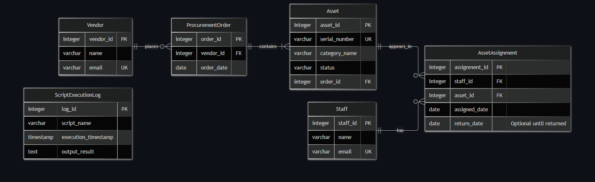

# MIT 8103 Advanced Database Systems: Portfolio Summary

Alliance Chemicals Global IT Procurement

Name: Emmanuel Anifowoshe

Student ID: 301929334

GitHub: https://github.com/biyidevops/Anifowoshe_Emmanuel_301929334

## Case study
The IT procurement system records staff, hardware assets, vendors, and assignments. IT staff assign hardware (such as laptops and monitors) to employees, track returns, and monitor unassigned inventory. The example covers the operations of Alliance Chemicals Global using fictional records. PostgreSQL holds the core relational inventory and assignment records; MongoDB holds a separate sample of asset deployment and return events. Both run in one GitHub Codespace.

## Portfolio 1: Database Design and Modelling
The relational design includes tables such as staff, asset, vendor, procurementorder, and assetassignment. Separating hardware assets from staff members and vendors allows multiple assets to be managed independently of their users. Each table has a primary key. Foreign keys connect assignments to existing staff and assets, and assets to their procurement orders. Constraints reject invalid dates and ensure data integrity. A unique partial index permits only one open assignment per physical asset. The normalisation examples demonstrate a combined assignment list becoming one assignment per row in 1NF. Asset details are separated from the assignment records in 2NF. Vendor and staff details move to their own respective tables in 3NF. The schema, ER diagram, and normalisation tables are saved in Portfolio 1. Six invalid inserts are rejected by the intended rules. At that stage, the records contain multiple staff members, assets, and assignments.

*Figure 1. The six database tables and their relationships, where PK identifies a unique row and FK links tables together. Each asset assignment connects one staff member to one specific asset, while each asset links back to a procurement order and vendor. The standalone script execution log tracks automated administrative tasks, while a staff member, vendor, or order can have zero or many related records within the core system.*

## Portfolio 2: Query Processing and Optimisation
Three queries retrieve open assignments, available inventory, and assignment counts per staff member. At this stage, James Babalola has one open laptop assignment, Emmanuel Anifowoshe has one open toner assignment, and one router remains unassigned. Emmanuel Anifowoshe has two total historical assignments, while James Babalola has one. A separate table, p2_benchmark.assetassignment_history, contains 100,000 generated closed-assignment records for the speed test, leaving the original lending records unchanged.

The same date-range count returns 1,674 rows before and after an index on assigned_date. EXPLAIN (ANALYZE, BUFFERS) records the plan and actual execution. After warm-up runs, the third measured run gives:

| Measurement | Before index | After index |
| :--- | :--- | :--- |
| Scan | Seq Scan | Bitmap Heap Scan |
| Execution time (third run) | 5.850 ms | 0.415 ms |
| Shared buffer hits (third run) | 736 | 74 |

The index avoids scanning unrelated dates in this test. These cached, shared-Codespace measurements do not predict every workload. Indexes also require storage and maintenance.

## Portfolio 3: Transactions and Concurrency
A hardware return is saved with COMMIT. Repeating the conditional return changes zero rows. In another transaction, a valid assignment is followed by an invalid date entry. ROLLBACK removes the unsaved assignment while keeping the earlier committed return.

Two sessions then use READ COMMITTED isolation. Session A inserts a new asset assignment without committing. Session B cannot see that uncommitted assignment and tries to assign the same hardware asset. Its insert waits. After Session A commits, Session B receives a duplicate-key error from the unique partial index and rolls back. The final result is one open assignment for that asset. This shows why an earlier availability check alone is insufficient. The unique index enforces the one-open-assignment rule during concurrent inserts. The conditional return demonstrates the update workflow, not protection against every possible direct edit.

## Portfolio 4: NoSQL and Advanced Data Models
MongoDB stores four documents in the it_events.asset_events collection. Each event embeds staff and asset details, a date, and event-specific details. An assignment contains a deployment location; a return contains the hardware's condition. This keeps the information for one event together.

The insert is acknowledged for EVT001-EVT004, and the count is four. The SN001 query returns its initial assignment, its return, and its reassignment. Searching details.condition for "requires maintenance" returns EVT002, Chukwudi Okafor's laptop return. These are separately entered sample events, not automatic PostgreSQL synchronisation or a complete audit log. Embedded names are snapshots. PostgreSQL remains responsible for relational assignment constraints.

## Portfolio 5: Distributed and Cloud Database Exercise
The discussion proposes three voting, data-holding MongoDB replica members on separate hosts and failure zones (Lagos HQ, Nairobi Branch, and a Cloud Region). A primary accepts event writes; secondaries copy changes. If a primary fails, a reachable majority can elect an eligible replacement. Writes pause during the election. Majority acknowledgement and possible secondary lag affect durability, availability, and recent-event reads.

Sharding divides records rather than copying the full set. Four sample events do not justify it. A managed cloud deployment would also need authentication, encryption, restricted access, and tested backups. Replication does not replace backups or protect PostgreSQL automatically. This is a proposed design: no replica set, sharding, or failover experiment was implemented.

## Evidence
Scripts, explanations, and screenshots: P1 design and tests, P2 plans and timings, P3 transactions, P4 events, P5 proposal. Earlier screenshots record earlier database states; Portfolio 3 changes the original assignments.

## Individual reflection
For the MongoDB NoSQL model, I chose to embed the staff name and hardware serial number directly inside the asset_events document rather than referencing other collections. This ensures the event log acts as an immutable snapshot. Even if an employee changes their name later in the main relational database, the NoSQL event log preserves exactly who they were when the asset was assigned.

Managing the simultaneous database connections in Portfolio 3 (Session A and Session B) was challenging. I accidentally ran commands in the wrong order or in the wrong terminal, which caused the expected lock wait states to fail, forcing me to repeatedly restart the exercise. To fix this, I slowed down my workflow, clearly separated my two terminal windows, and executed the SQL commands line-by-line exactly as structured in the scripts, making sure to verify the lock state in one terminal before proceeding in the other. I learned the critical importance of patience and attention to detail when working with concurrent systems, as timing and execution order are everything when testing transactional locks.

## References
[1] PostgreSQL Global Development Group. PostgreSQL 16: Using EXPLAIN. https://www.postgresql.org/docs/16/using-explain.html

[2] PostgreSQL Global Development Group. PostgreSQL 16: Transaction Isolation. https://www.postgresql.org/docs/16/transaction-iso.html

[3] MongoDB. Data Modeling in MongoDB. https://www.mongodb.com/docs/manual/data-modeling/

[4] MongoDB. Replication. https://www.mongodb.com/docs/manual/replication/

[5] MongoDB. Sharding. https://www.mongodb.com/docs/manual/sharding/

## AI-use declaration
I used Google Gemini and GitHub Copilot to explain database concepts, troubleshoot Codespaces errors, and review the structure and wording of my portfolio. I executed the database commands myself, verified the query outputs, edited the SQL schemas to fit my case study, and checked the results against the assessment requirements before submission. I understand the work and remain responsible for its accuracy.
