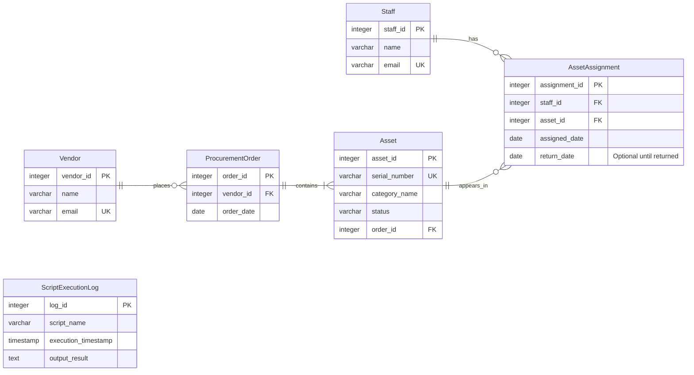

# Alliance Chemicals Global IT Procurement ER Diagram

This diagram shows the six tables, their fields and how they connect.

## Reading the diagram

- **PK** identifies one record. **FK** links to another table. **UK** means a value is unique.

- `||` means exactly one. `o{` means zero or many. `|{` means one or many.

- A vendor can place zero or many procurement orders. Each order belongs to one vendor.

- A procurement order contains one or many assets. Each asset belongs to one order.

- A staff member can have zero or many asset assignments. Each assignment belongs to one staff member.

- An asset can appear in zero or many assignments over time. Each assignment refers to one asset.

- The script execution log stands alone as an independent append-only record.

For example, a laptop (asset 10) can be assigned to a staff member in January, returned, and assigned to a different staff member in February. These are two separate assignment records.

All fields are required except return_date. The diagram shows assignment history; the separate rules preventing concurrent assignments of the same asset or assigning deployed assets are covered in the database design. Script immutability rules are also described there.